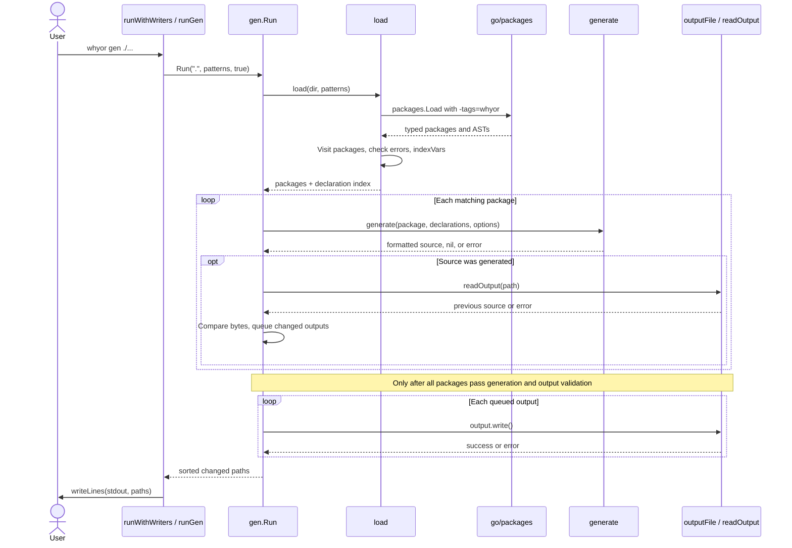
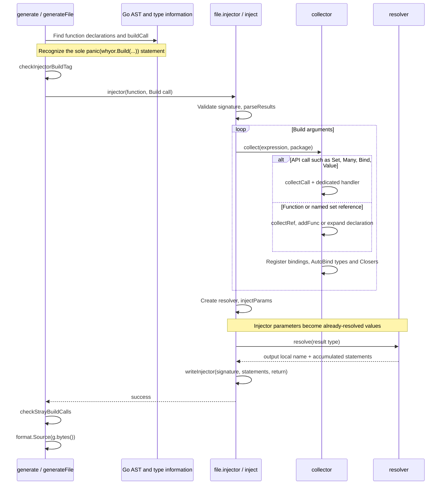
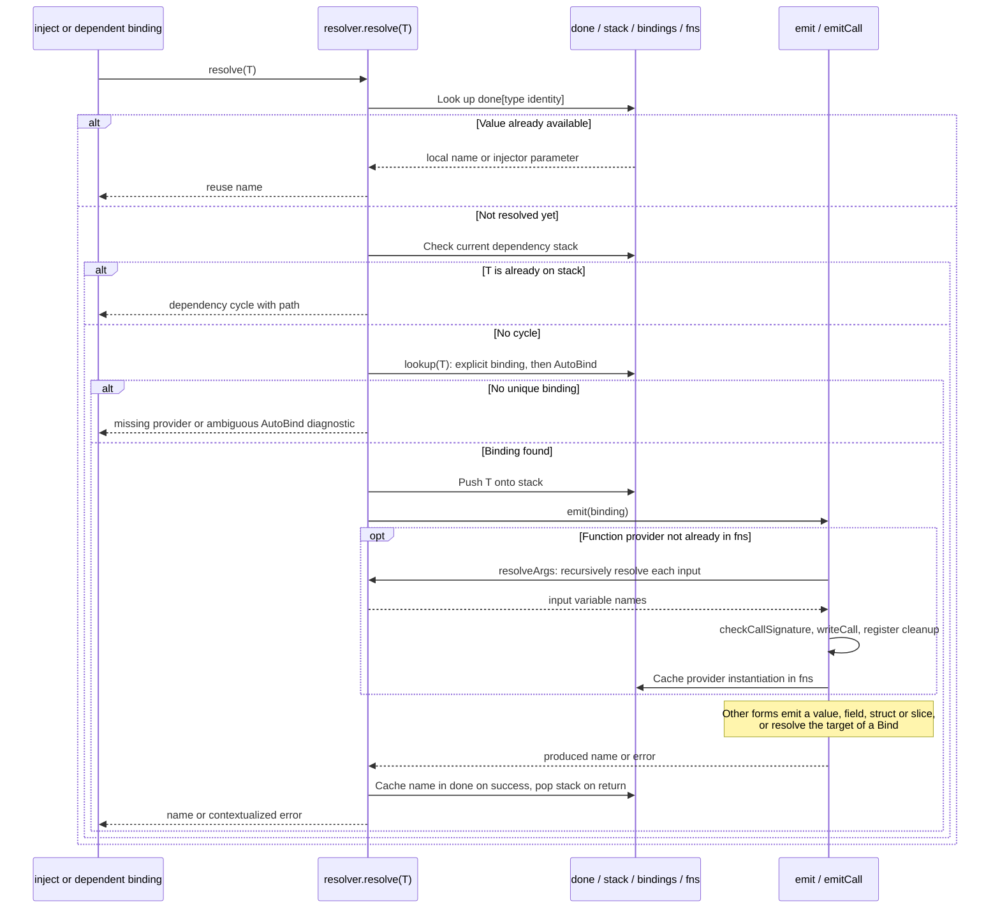
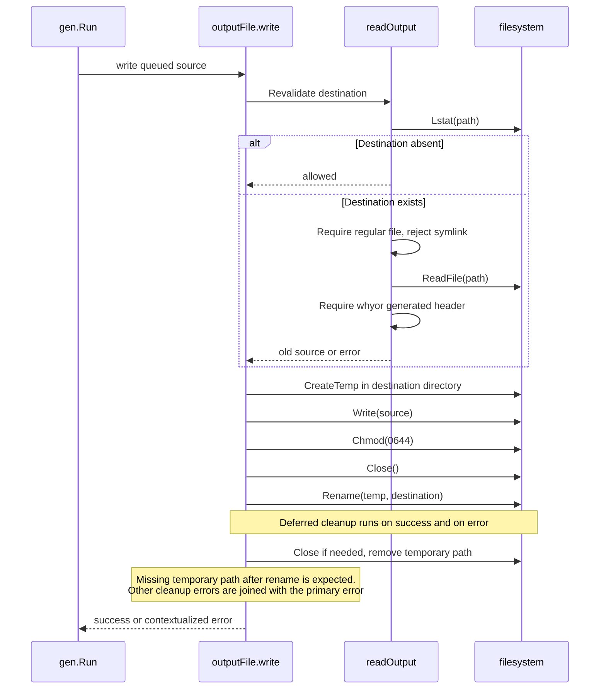
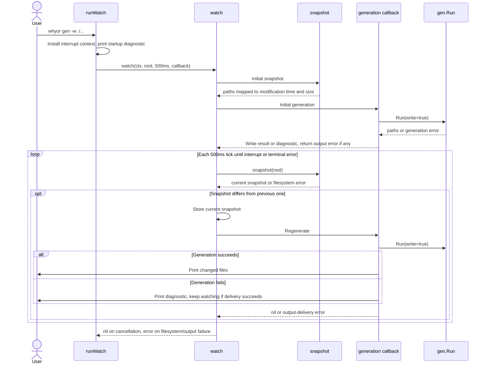
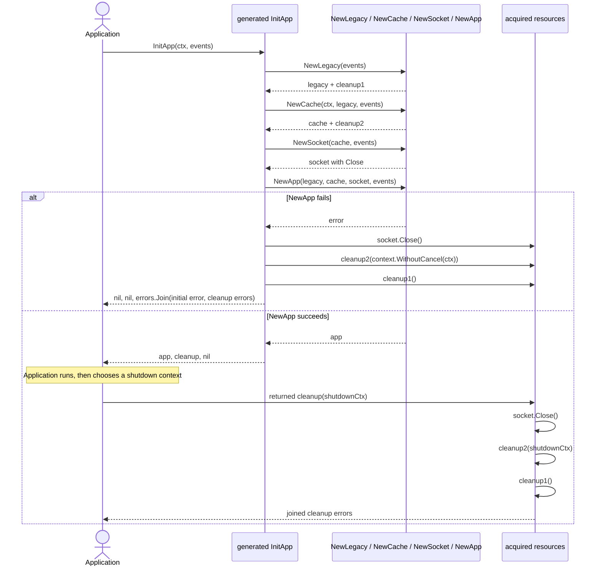
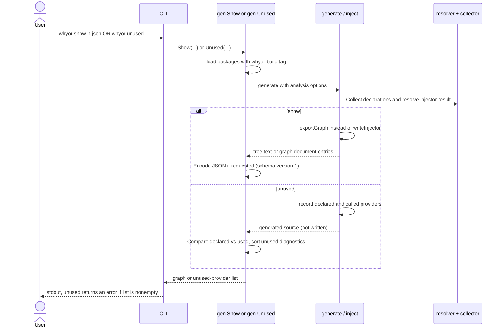

# Source code sequence diagrams

These diagrams describe the v0.12.1 implementation. Participant labels refer
to functions or internal objects, not network services. Solid arrows are calls;
dashed arrows are returns. Error branches terminate the relevant operation even
when the diagram omits the remaining return arrows for readability.

**The key distinction:** the generator inspects constructors and writes Go code;
it does not execute those constructors. Your compiled application executes the
generated injector later, without a runtime DI container.

## 1. From the CLI to generated files

Sources: [CLI dispatch](../cmd/whyor/main.go),
[package loading and generation](../internal/gen/gen.go).

- `check` follows the same path with `write=false`. It does not write files and
  fails if any generated file is stale.
- A generation/validation error prevents the write phase. An I/O error during
  that phase can leave earlier files updated: **this is not a multi-file transaction**.
- CLI output errors are returned too; successful generation does not guarantee
  that printing its result succeeds.

## 2. Turning an injector declaration into code

Sources: [generateFile and buildCall](../internal/gen/gen.go),
[inject and its helpers](../internal/gen/emit.go),
[collector](../internal/gen/collect.go).

The collector describes **what is available**. The resolver decides **what is
needed and in which order**. `checkStrayBuildCalls` rejects `Build` calls outside
recognized injector declarations. No constructors execute in this sequence.

## 3. Recursive resolution, reuse and errors

Sources: [resolve, lookup and emission helpers](../internal/gen/resolve.go),
[type identity](../internal/gen/types.go).

- `done` caches by Go type identity, not printed type name.
- `fns` reuses calls by provider identity **including generic type arguments**.
- `stack` detects cycles along the current resolution path, not across all
  previously visited nodes.
- Dependency resolution happens before the dependent call is emitted; this
  produces constructor calls in dependency order.

## 4. Validating and replacing an output file

Source: [output.go](../internal/gen/output.go).

This avoids truncating an existing output before replacement. It is not a
promise of multi-file atomicity, crash durability, or protection against every
concurrent filesystem race.

## 5. Watch mode and error recovery

Sources: [runWatch](../cmd/whyor/main.go),
[watch and snapshot](../cmd/whyor/watch.go).

`snapshot` ignores `*_gen.go`, hidden directories, `vendor` and `testdata`.
It detects changes using paths, modification times and sizes, not content hashes.
A file disappearing during polling is a normal deletion; a missing root is an
error. Failed generation is retried **on a subsequent detected change**, not
automatically on every tick.

## 6. Runtime constructors and reverse-order cleanup

This sequence is **application runtime**, not generator execution. It follows
the actual [generated lifecycle example](../examples/lifecycle/whyor_gen.go),
specifically `InitApp`. The caller invokes the returned cleanup; it is not
scheduled automatically by whyor.

This is the context-aware cleanup form. Legacy `func()` cleanup has no error
return. Cleanup order reverses successful acquisition order; it is sequential,
not concurrent. Without an injector context, generated rollback uses
`context.Background()`. The caller must provide shutdown deadlines as needed.

## 7. Graph display and unused-provider analysis

Source: [Show and Unused](../internal/gen/gen.go),
[exportGraph and record](../internal/gen/emit.go).

These commands share the resolver with generation; they do not execute
constructors or write generated output files. `show -f mermaid` exports a
**dependency graph**, not the source-code sequence diagrams in this document.

## Suggested source-reading order

1. [cmd/whyor/main.go](../cmd/whyor/main.go): dispatch and CLI error handling.
2. [internal/gen/gen.go](../internal/gen/gen.go): package loading and orchestration.
3. [internal/gen/collect.go](../internal/gen/collect.go): declarations into bindings.
4. [internal/gen/emit.go](../internal/gen/emit.go): injector orchestration and rendering.
5. [internal/gen/resolve.go](../internal/gen/resolve.go): recursive resolution and cleanup emission.
6. [internal/gen/output.go](../internal/gen/output.go): filesystem operations.
7. [examples/lifecycle/whyor_gen.go](../examples/lifecycle/whyor_gen.go): the result that actually runs.
